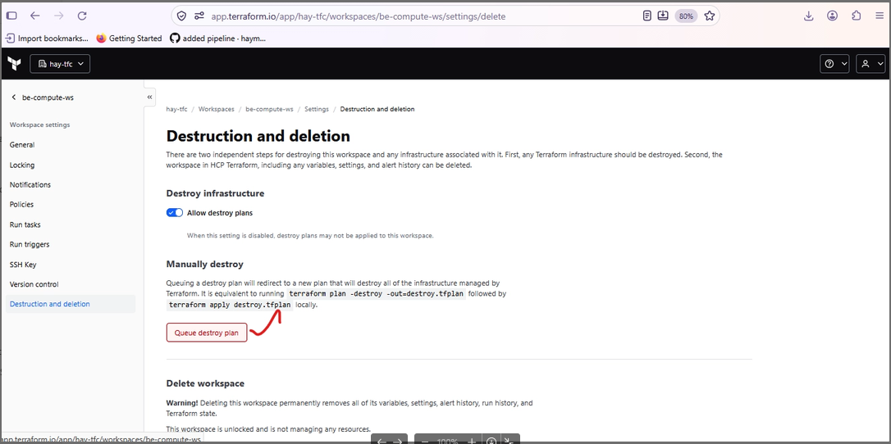
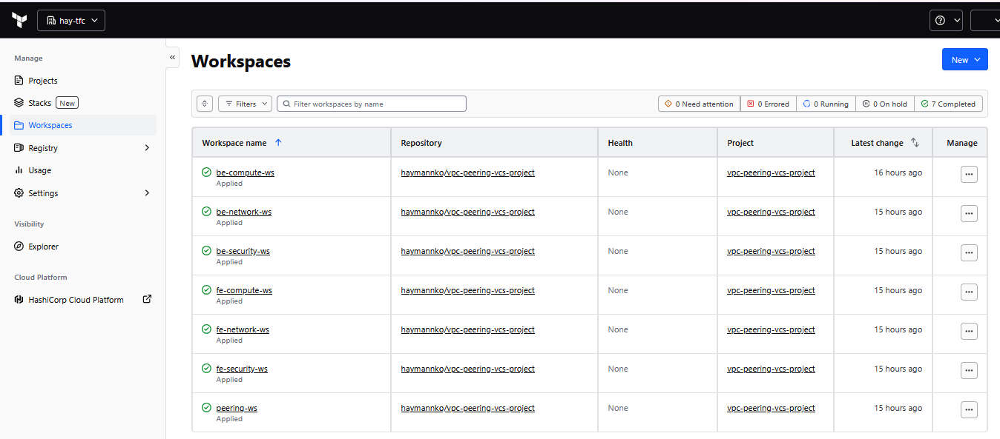
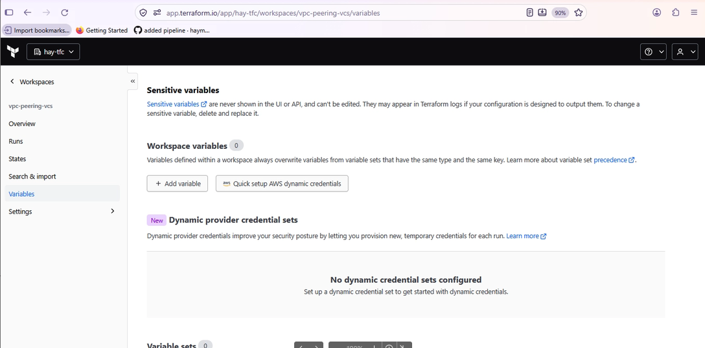
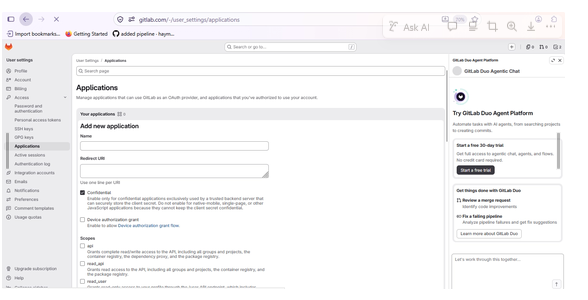
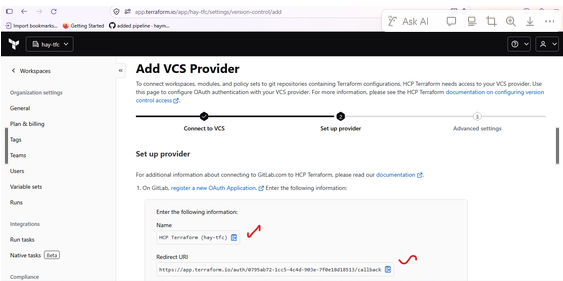
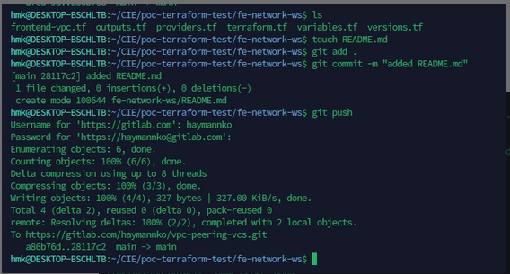
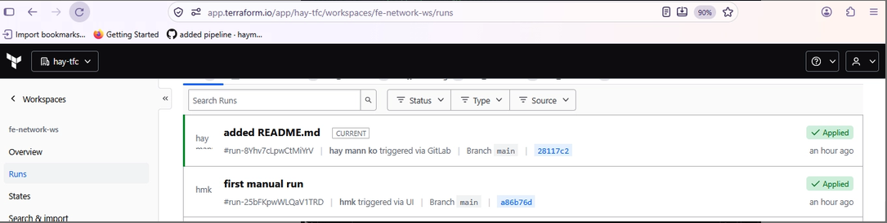

## HCP Terraform remote execution runs your Terraform plans and applies securely on HashiCorp’s managed cloud infrastructure instead of your local machine, the state file is automatically stored, locked, and updated securely in the cloud during every run  


### Clickops with excalidraw
https://link.excalidraw.com/l/5XayvvYquoD/IDLJFFTG6S

### To create Workspace =>config file HCP Terraform
terraform.tf


### Workspaces
#### Create fe-network-ws, be-network-ws, peering-ws, fe-security-ws, be-security-ws, be-compute-ws, fe-security-ws 
Run terraform login and take token from account settings 
https://app.terraform.io


### need to add variables AWS Access Key and AWS Secret Key in Projects of workspace 

#### Run
terraform init  
terraform fmt  
terraform validate  
terraform apply --auto-approve =>step by step according to below

Step 1 fe-network-ws  
Step 2 be-network-ws  
Step 3 peering-ws  
Step 4 fe-security-ws  
Step 5 be-security-ws  
Step 6 fe-compute-ws  
Step 7 be-compute-ws  

In Steps, create outputs.tf due to need to reference for next steps by data.tf

outputs.tf

```
output "frontend_vpc_id" {
  description = "Frontend VPC ID"
  value       = aws_vpc.frontend_vpc.id
}

output "private_route_table_ids" {
  description = "frontend private route table IDs"
  value = [
    aws_route_table.frontend_private_rtb01.id,
    aws_route_table.frontend_private_rtb02.id,
    aws_route_table.frontend_private_rtb03.id
  ]
}

output "vpc_cidr_block" {
  value = aws_vpc.frontend_vpc.cidr_block
}

output "frontend_private_rtb02" {
  value = aws_route_table.frontend_private_rtb02.id
}

output "frontend_private_rtb03" {
  value = aws_route_table.frontend_private_rtb03.id
}

output "frontend_public_subnet01" {
  value = aws_subnet.frontend_public_subnet01.id
}

output "frontend_public_subnet02" {
  value = aws_subnet.frontend_public_subnet02.id
}

output "frontend_public_subnet03" {
  value = aws_subnet.frontend_public_subnet03.id
}

output "frontend_private_subnet01" {
  value = aws_subnet.frontend_private_subnet01.id
}

output "frontend_private_subnet02" {
  value = aws_subnet.frontend_private_subnet02.id
}

output "frontend_private_subnet03" {
  value = aws_subnet.frontend_private_subnet03.id
}
```

data.tf
```
data "terraform_remote_state" "backend_network" {
  backend = "remote"

  config = {
    organization = "hay-tfc"

    workspaces = {
      name = "be-network-ws"
    }
  }
}

data "terraform_remote_state" "frontend_network" {
  backend = "remote"

  config = {
    organization = "hay-tfc"

    workspaces = {
      name = "fe-network-ws"
    }
  }

}

data "terraform_remote_state" "backend_security" {
  backend = "remote"

  config = {
    organization = "hay-tfc"

    workspaces = {
      name = "be-security-ws"
    }
  }
}
```

```
resource "aws_vpc_security_group_ingress_rule" "fe_private_sg03_allow_icmp_from_be_private_sg03" {
  security_group_id            = aws_security_group.fe_private_sg03.id
  referenced_security_group_id = data.terraform_remote_state.backend_security.outputs.be_private_sg03_id
  from_port                    = 8
  ip_protocol                  = "icmp"
  to_port                      = 0
}

resource "aws_vpc_security_group_egress_rule" "fe_private_sg03_allow_ssh_to_be_private_sg03" {
  security_group_id            = aws_security_group.fe_private_sg03.id
  referenced_security_group_id = data.terraform_remote_state.backend_security.outputs.be_private_sg03_id
  from_port                    = 22
  ip_protocol                  = "tcp"
  to_port                      = 22
}
```

#### State file
After terraform apply => can check workspaces and statefile







#### Check in AWS









#### Donot forget to destroy => destroy strictly not to face error
terraform destroy --auto-apporve


